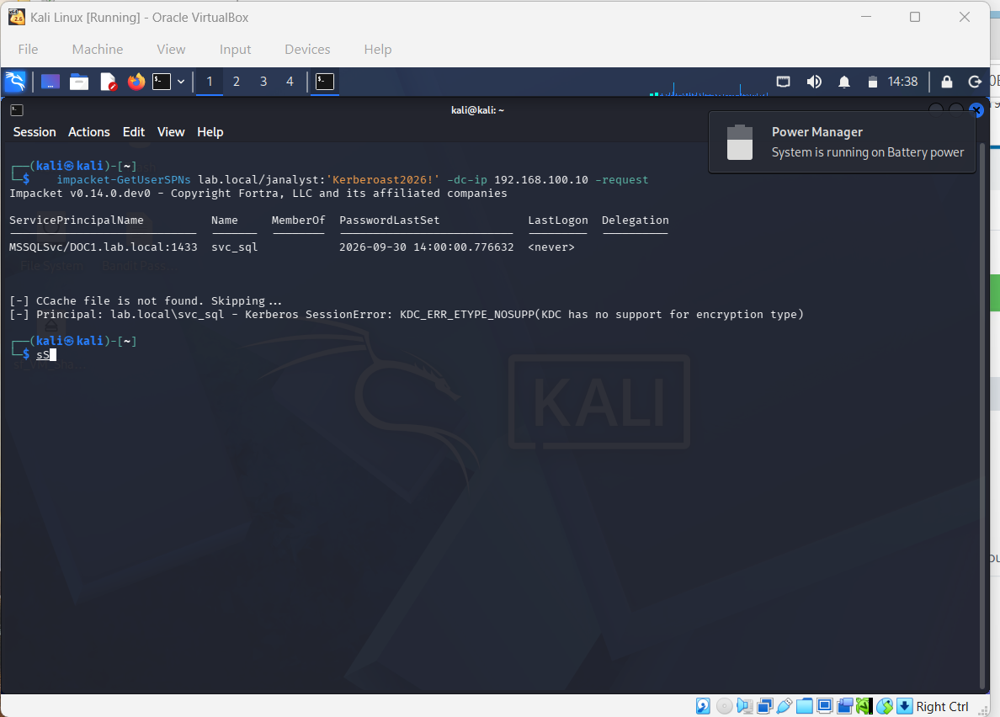
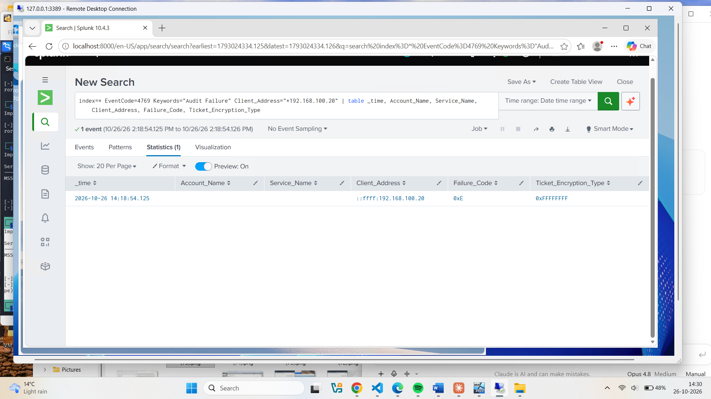
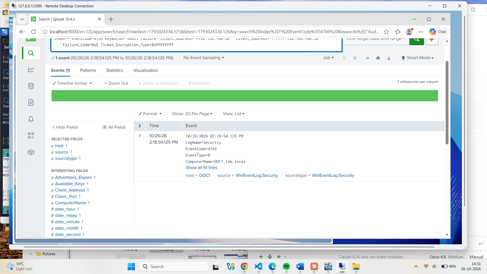

# Active Directory Attack & Detection Lab — Kerberoasting

**Author:** Praveen Gaikwad
**Date:** October 2026
**Environment:** Personal VirtualBox lab (isolated internal network, no production data)

## 1. Objective

Kerberoasting is one of the most common techniques an attacker uses to move from a low-privilege foothold toward privileged credentials in an Active Directory domain. This project builds a small AD environment, performs a Kerberoasting attack against it (MITRE ATT&CK **T1558.003**), and — the real focus — builds the detection for it in Splunk.

The project deliberately surfaced two findings that only appear when you actually run the attack rather than read about it:

1. A modern domain controller (**Windows Server 2025**) refused the attack outright because of its default encryption hardening — a control, not a setup error.
2. With **default audit settings**, that blocked attempt generated **no log at all**. The attack was only made visible after enabling failure auditing — a genuine detection gap.

The goal was to practise the full defender lifecycle: **build → attack → observe what is (and isn't) logged → tune logging → detect → confirm.**

## 2. Scope

| Component | Role | Details |
|---|---|---|
| `DOC1` | Domain Controller / target | Windows Server 2025, domain `lab.local`, IP `192.168.100.10`, runs Sysmon + Splunk |
| `Kali` | Attacker | Kali Linux, IP `192.168.100.20`, runs Impacket |
| `labnet` | Network | VirtualBox Internal Network — fully isolated from host and internet |

**Deliberately vulnerable setup:** a low-privilege domain user `janalyst`, and a service account `svc_sql` with a registered Service Principal Name (`MSSQLSvc/DOC1.lab.local:1433`) — the exact condition Kerberoasting targets.

## 3. Methodology

1. Promote `DOC1` to a domain controller for `lab.local`; create `janalyst` and the SPN-registered service account `svc_sql`.
2. Install Sysmon and forward both Sysmon and Windows Security logs into Splunk.
3. From Kali, run a Kerberoasting attack with Impacket's `GetUserSPNs`, authenticating as the low-privilege `janalyst`.
4. Observe the result on both sides — the attacker's output, and what landed in Splunk.
5. Where the attack left no log, identify why and tune the audit policy.
6. Re-run the attack and confirm the detection fires.

## 4. The Attack

From Kali, authenticating as the low-privilege user and requesting a service ticket for every SPN in the domain:

```
impacket-GetUserSPNs lab.local/janalyst:'<password>' -dc-ip 192.168.100.10 -request
```

**Result:** the attack successfully authenticated and enumerated the target service account, but the ticket request itself was refused:

```
ServicePrincipalName          Name     MemberOf  PasswordLastSet
----------------------------  -------  --------  --------------------------
MSSQLSvc/DOC1.lab.local:1433  svc_sql            2026-09-30 14:00:00

[-] Principal: lab.local\svc_sql - Kerberos SessionError:
    KDC_ERR_ETYPE_NOSUPP (KDC has no support for encryption type)
```


*The attack enumerates the svc_sql SPN but the DC refuses to issue a roastable ticket.*

**Why it failed — this is the first finding, not a failure:** Kerberoasting relies on the DC issuing a service ticket encrypted with **RC4 (etype 0x17)**, which is weak enough to crack offline. Windows Server 2025 disables RC4 by default, so the DC had no weak encryption type to offer and rejected the request with `KDC_ERR_ETYPE_NOSUPP`.

**Impact:** on a modern, default-configured domain, this specific attack is blocked at the protocol level. On the many production domains still running older Windows Server versions, or with RC4 re-enabled for legacy compatibility, the same attack would succeed — so the technique remains a live risk and is worth detecting regardless.

## 5. The Detection

### 5.1 The logging gap

The attack was run and blocked — but a search for the service account returned **nothing**:

```
index=* EventCode=4769 svc_sql
→ No results found
```

The only Kerberos service-ticket events present were routine domain background activity (the DC's own computer account `DOC1$` and the `krbtgt` account), all **Audit Success**.

**Root cause:** Windows only logs **successful** Kerberos service-ticket requests (Event ID 4769) by default. The attack was *refused*, so under the default policy it produced no event at all. **An analyst relying solely on default logging would have no record that a Kerberoasting attempt ever happened.**

### 5.2 Closing the gap

Failure auditing for Kerberos ticket operations was enabled on the DC:

```
auditpol /set /subcategory:"Kerberos Service Ticket Operations" /failure:enable
```

The attack was then re-run from Kali.

### 5.3 Confirmed detection

This time the blocked attempt was captured. A targeted Splunk search isolated it from all background noise:

```
index=* EventCode=4769 Keywords="Audit Failure" Client_Address="*192.168.100.20"
| table _time, Account_Name, Service_Name, Client_Address, Failure_Code, Ticket_Encryption_Type
```


*A single Event 4769 Audit Failure, originating from the attacker's IP.*

| Field | Value | Meaning |
|---|---|---|
| `EventCode` | 4769 | Kerberos service-ticket request |
| `Keywords` | Audit Failure | The request was refused, not granted |
| `Client_Address` | `::ffff:192.168.100.20` | Originated from the attacker (Kali) |
| `Failure_Code` | `0xE` | `KDC_ERR_ETYPE_NOSUPP` — refused for unsupported encryption |
| `Ticket_Encryption_Type` | `0xFFFFFFFF` | No (weak) encryption type could be negotiated |


*The full Event 4769 on the domain controller DOC1.lab.local.*

The failure code itself tells the story: an attempt to request a service ticket, refused because the only usable (weak) cipher was unavailable. Correlated with the source IP, this is a high-confidence Kerberoasting indicator.

## 6. Recommendations

| Finding | Recommendation |
|---|---|
| RC4 still enabled on legacy domains | Disable RC4 for Kerberos domain-wide (as Server 2025 does by default); enforce AES. This alone neutralises classic Kerberoasting. |
| Blocked attempts invisible by default | Enable **failure** auditing for Kerberos Service Ticket Operations, not just success — otherwise refused attacks leave no trace. |
| Successful Kerberoasting hard to spot | Alert on Event 4769 where `Ticket_Encryption_Type = 0x17` (RC4) against user service accounts — the signature of a successful roast where RC4 is still allowed. |
| Weak service-account passwords | Use long, random, managed service-account passwords (gMSA) so that even a captured ticket is not crackable offline. |
| Single data source | Correlate 4769 with the source host (Sysmon process creation, Event 4688) to tie the request to the specific tool and user session. |

## 7. Key Takeaways

- **Modern defaults matter.** Windows Server 2025's RC4 deprecation blocked a classic attack outright — a concrete example of secure-by-default configuration doing real work.
- **"Blocked" is not the same as "detected."** The attack was stopped at the protocol level but, under default logging, was completely invisible. Prevention and detection are separate problems.
- **Audit policy is part of detection engineering.** The single most important step here was enabling failure auditing — without it, the best SPL search in the world has nothing to find.
- **The failure itself is the signal.** A 4769 Audit Failure with an encryption-type failure code, from a workstation IP against a service account, is a strong Kerberoasting indicator in its own right.
- **Infrastructure reliability is part of the job.** Getting to the detection meant resolving real operational issues — Splunk ingestion permissions on the Sysmon channel, Kerberos clock skew between attacker and DC, and non-persistent lab networking.

## 8. Tools Used

VirtualBox (Internal Network mode), Windows Server 2025 (Active Directory Domain Services), Kali Linux, Impacket (`GetUserSPNs`), Sysmon, Splunk, Windows Event Logs, `auditpol`, `setspn`, PowerShell.

## 9. References

- [MITRE ATT&CK T1558.003 — Kerberoasting](https://attack.mitre.org/techniques/T1558/003/) — technique reference
- [Microsoft — Audit Kerberos Service Ticket Operations (Event 4769)](https://learn.microsoft.com/en-us/windows/security/threat-protection/auditing/event-4769) — event field reference
- [Microsoft — KB5021131: Managing the Kerberos RC4 removal](https://support.microsoft.com/en-us/topic/kb5021131) — background on RC4 deprecation

---

*This lab was built and tested in a personal, isolated VirtualBox environment using synthetic accounts. No production systems or real data were involved.*
